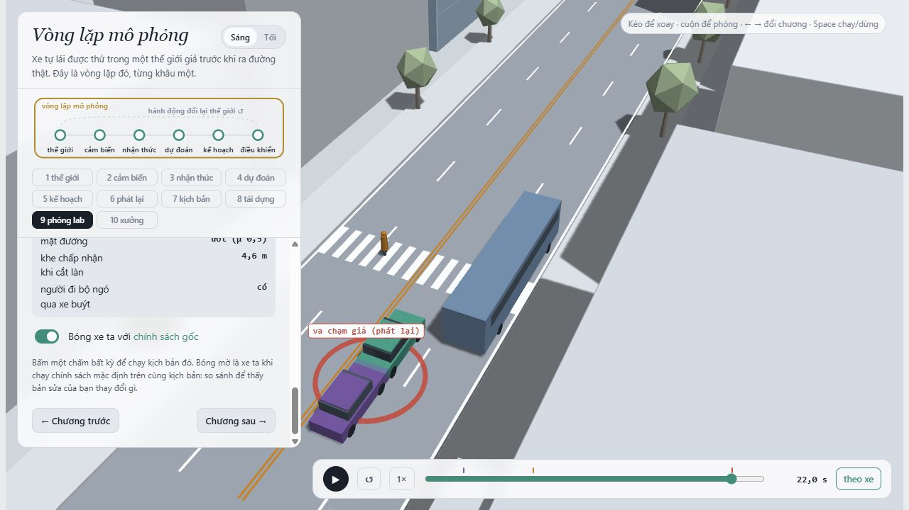
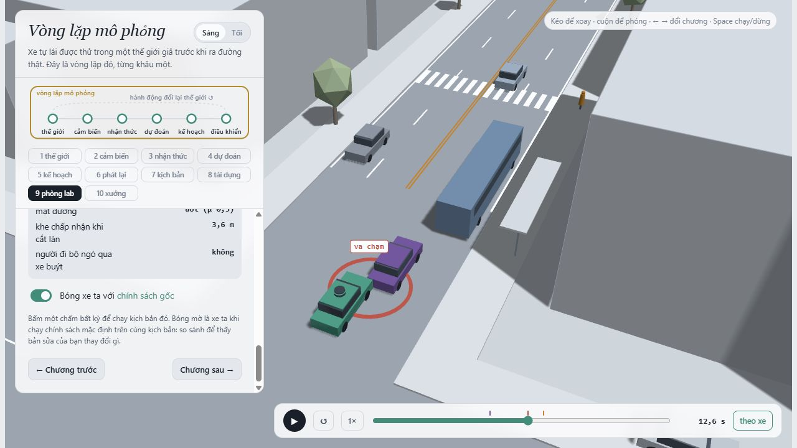
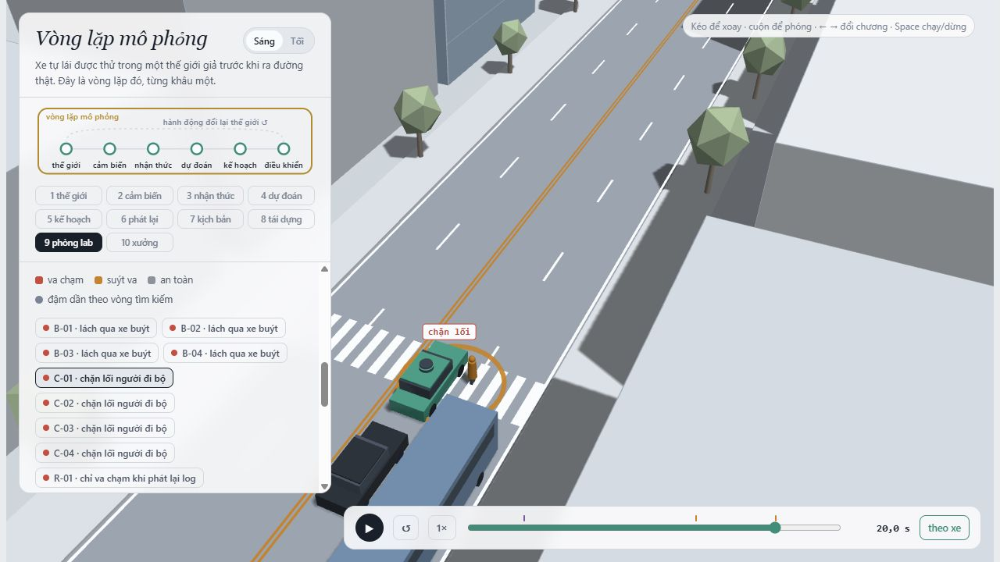
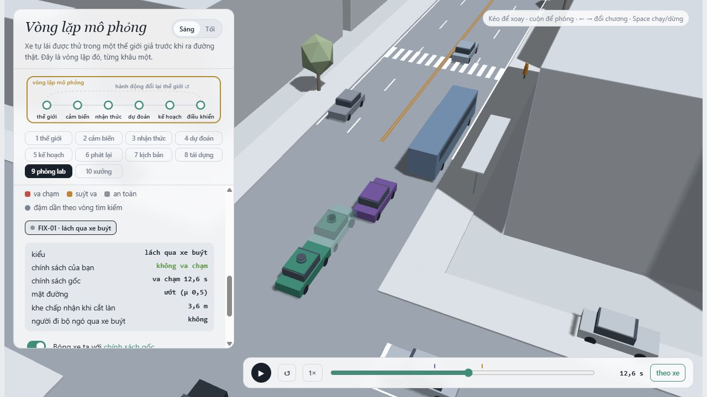
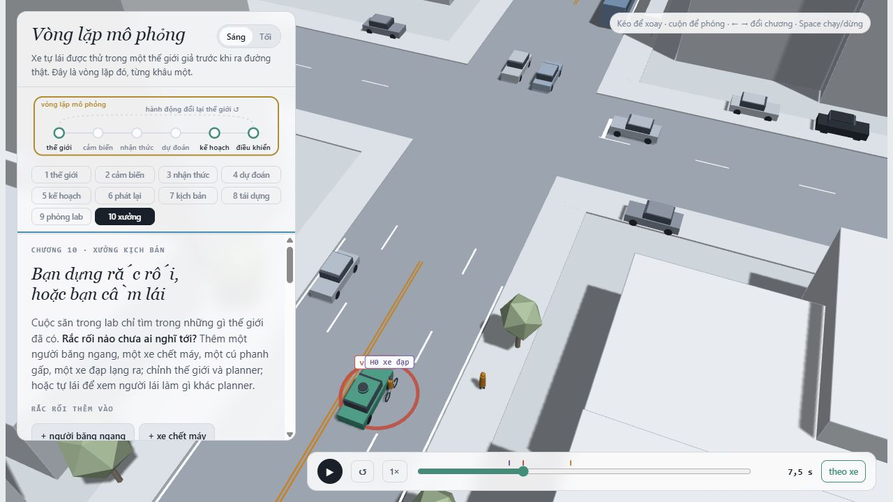
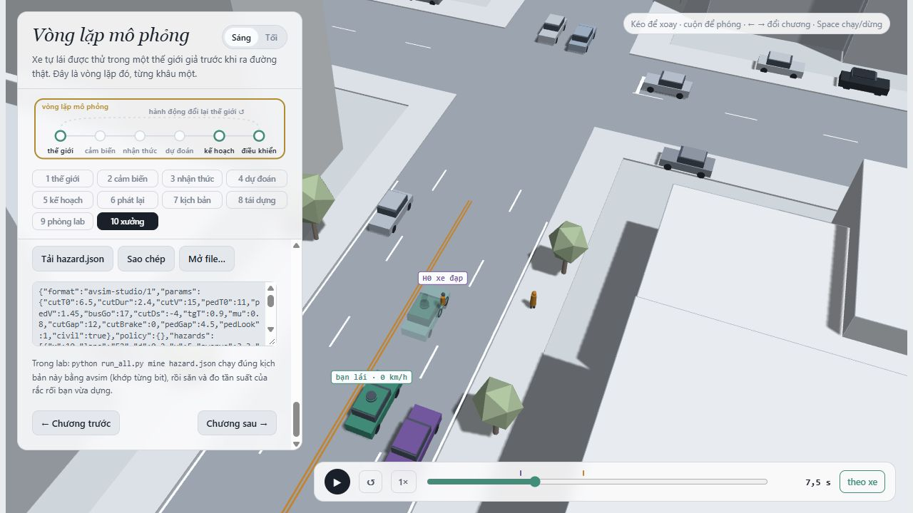

MSSV: 2202602599

# Lab 11 · Scenario Forge — báo cáo

**Sinh viên:** Lưu Quang Khải. **Thị trấn:** B (`meta.json: _run.town`).

Tôi dùng ngân sách đầy đủ, không dùng `--quick` cho bằng chứng nộp. Thông số: 400 replay, 3.000 Monte Carlo, 8 vòng × 300 mẫu cho mỗi cuộc săn, IS 600 mẫu/kiểu/seed × 3 seed, 400 mẫu/kiểu khi so policy, 256 mẫu progress TRAIN và 3.000 mẫu tự nhiên TEST, 1.500 mẫu hazard (`meta.json: _run.budgets`). Seed được suy ra từ MSSV; không sửa lõi mô phỏng, phân phối tự nhiên, seed hay danh sách policy có sẵn.

## 1. Phát lại log có trung thực không?

Nguồn: `replay.json: n, dropped_human_crash_logs, replay, reactive, crash_in_both`.

| Chỉ số | Giá trị |
|---|---|
| Kịch bản lấy mẫu | 400 |
| Log bị bỏ vì người lái va chạm | 0 |
| Kịch bản dùng | 400 |
| Va chạm cả hai cách | 0 |

| Thế giới | Tổng thất bại | front | rear | side |
|---|---|---|---|---|
| Log phát lại | 99 | 0 | 92 | 7 |
| Tác nhân phản ứng | 0 | 0 | 0 | 0 |

Log lưu phản ứng của giao thông với người lái gốc. Planner phanh sớm hơn người lái, nhưng xe phía sau trên log vẫn giữ đúng quỹ đạo cũ, nên có thể đâm vào ego. Trong mô phỏng phản ứng, nó có thể phanh theo ego. Vì vậy phần lớn va chạm `rear` ở replay là hệ quả của phản thực không nhất quán, không phải bằng chứng planner thực sự nguy hiểm ở mức đó.

Ví dụ `replay.json: replay_only[0]`, scenario 0: xe C2 đâm phía sau ego lúc 21.95 s khi phát lại, còn bản reactive không có sự kiện ego; `min_ttc_reactive=7.52685` s. Ở đây xe đâm phía sau là C2, không mặc định là TG. Chương 9 hiện vòng đỏ “va chạm giả (phát lại)”. Chi tiết frame được chạy chẩn đoán thêm trong `scene_analysis.json: replay_example`, không dùng các rollout này để tính xác suất.



## 2. Kịch bản bất khả thi

`lab11/feasible.py: is_feasible` loại kịch bản khi một trong bốn điều kiện sau đúng:

| Điều kiện loại | Căn cứ trong mô hình |
|---|---|
| `(pi/cutDur)^2 * 3.5/2 > mu*g` | Chuyển làn cosine cần gia tốc ngang vượt lực bám lốp |
| `cutBrake > mu*g` | Phanh sau nhập làn vượt giới hạn ma sát |
| `pedV > 2.5 m/s` | Vượt miền người đi bộ của lab |
| `cutV <= 0` hoặc `cutV > 22 m/s` | Ngoài miền xe chuyển làn mà lab cho phép |

Hàm còn trả False nếu `cutDur<=0` để tránh phép chia không hợp lệ; đây là kiểm tra đầu vào, không thay đổi miền phân phối tự nhiên.

| Cuộc săn | Mẫu bất khả thi | Thất bại đúng mục tiêu | Toàn bộ found |
|---|---|---|---|
| bus_bypass | 7 | 117 | {"bus_bypass": 117} |
| cut_in | 4 | 0 | {"bus_bypass": 22} |
| crosswalk_block | 17 | 54 | {"bus_bypass": 2, "crosswalk_block": 54} |
| rear_ended | 21 | 0 | {"bus_bypass": 3, "crosswalk_block": 32} |

Nguồn: `hunt.json: <mode>.infeasible, found`. Nhiều nhất là `rear_ended` với 21 mẫu. Điểm nguy hiểm có thể ưu tiên chuyển làn quá nhanh hoặc phanh quá mạnh; CEM tối ưu điểm số không tự biết vật lý. Bộ lọc được áp dụng trước mô phỏng và trước cập nhật elite. Nếu tính mẫu bất khả thi là va chạm, ta đo cả biến cố không thể xảy ra trong miền vật lý này, làm sai/tăng rủi ro thay vì chỉ phát hiện lỗi planner. Trong MC có 16 mẫu bị loại; mẫu đó không được tính là thất bại, mẫu số giữ theo quy ước runner.

## 3. Monte Carlo cho biết gì?

`mc.json`: k=4, n=3000, p̂=0.00133333; Wilson 95% = [0.000518617, 0.00342353]. Khoảng này còn rộng so với p̂. Với p nhỏ và mục tiêu nửa độ rộng 1,96·sqrt(p/n) ≈ 0,2p, cần n≈96/p; thay p̂ vào cho khoảng **72,000 lần chạy**, lớn hơn nhiều so với 3.000 lần hiện có. Đây là xấp xỉ lập ngân sách, không phải bảo đảm ở mọi mẫu.

| Kiểu | k | Wilson lo | Wilson hi |
|---|---|---|---|
| bus_bypass | 4 | 0.000518617 | 0.00342353 |
| cut_in | 0 | 0 | 0.0012789 |
| crosswalk_block | 0 | 0 | 0.0012789 |
| rear_ended | 0 | 0 | 0.0012789 |
| other | 0 | 0 | 0.0012789 |

Nguồn: `mc.json: per_mode`. Các kiểu chưa thấy là `cut_in`, `crosswalk_block`, `rear_ended`, `other`. Tôi báo cận trên Wilson tương ứng trong bảng, không kết luận xác suất bằng 0. Với 0/3.000, quy tắc ba cho cận xấp xỉ 0,001; Wilson hai phía trong runner cho cận trên 0.0012789. Không dùng khoảng chuẩn [0,0].

## 4. Importance sampling, ESS và độ suy biến

Lấy mẫu từ q=0,8·CEM+0,2·p và dùng w=p/q, nên w≤5. Tôi tính mean(w·y), không tự chuẩn hóa bởi sum(w); se=std(w·y, ddof=1)/sqrt(n), ESS=(sum w)^2/sum(w²). Các khoảng IS là xấp xỉ, không phải chứng nhận an toàn.

| Seed | Kiểu | p IS | hits | ESS | top_share | hi / upper_zero_hits |
|---|---|---|---|---|---|---|
| 0 | bus_bypass | 0.00126754 | 39 | 131.164 | 0.241755 | 0.0021745 |
| 0 | cut_in | chưa quan sát; xem cận trên | 0 | 136.208 | 0 | 0.025 |
| 0 | crosswalk_block | 3.07011e-06 | 53 | 125.464 | 0.858532 | 8.27281e-06 |
| 0 | rear_ended | chưa quan sát; xem cận trên | 0 | 121.576 | 0 | 0.025 |
| 1 | bus_bypass | 0.000857752 | 25 | 135.061 | 0.464923 | 0.00171784 |
| 1 | cut_in | chưa quan sát; xem cận trên | 0 | 128.971 | 0 | 0.025 |
| 1 | crosswalk_block | 4.3922e-06 | 53 | 126.064 | 0.935851 | 1.24512e-05 |
| 1 | rear_ended | chưa quan sát; xem cận trên | 0 | 113.242 | 0 | 0.025 |
| 2 | bus_bypass | 0.00134283 | 32 | 132.376 | 0.772966 | 0.00338392 |
| 2 | cut_in | chưa quan sát; xem cận trên | 0 | 117.399 | 0 | 0.025 |
| 2 | crosswalk_block | 7.7076e-07 | 67 | 122.03 | 0.279765 | 1.29881e-06 |
| 2 | rear_ended | chưa quan sát; xem cận trên | 0 | 133.134 | 0 | 0.025 |

Nguồn: `estimate.json: seeds[].per.<mode>`. Với hits=0, cột cuối dùng `upper_zero_hits=3/(0,2*600)=0,025`; giá trị 0 nội bộ của point estimator không được diễn giải là rủi ro bằng 0. Không dùng 3/ESS làm cận zero-hit.

| Seed | total | lo tổng | hi tổng | MC n xấp xỉ để cùng se |
|---|---|---|---|---|
| 0 | 0.00127061 | 0.000363644 | 0.00345648 | 5927 |
| 1 | 0.000862144 | 2.01415e-06 | 0.00300117 | 4473 |
| 2 | 0.0013436 | 0 | 0.00466359 | 1238 |

Nguồn: `estimate.json: seeds[].total, lo, hi`; cột MC n là phép tính bổ sung n≈p(1−p)/se² từ các se đã lưu, chỉ có ý nghĩa nếu ước lượng IS đang ổn định. `budget=16800` gồm cả các cuộc săn và IS; ngân sách MC đã chạy là 3000. Ba tổng IS chênh tối đa/tối thiểu 1.55844 lần; trung vị 0.00127061, so với MC 0.00133333. Không chọn seed đẹp nhất. Cần đối chiếu cả khoảng MC và độ biến động seed; cùng bậc độ lớn không đủ để khẳng định hội tụ. `hi` tổng của bước estimate được runner ghép từ se và cận `other`; nó không tự cộng các `upper_zero_hits` của từng kiểu mục tiêu chưa thấy, nên không được diễn giải thành cận chứng nhận toàn bộ xác suất thất bại.

`top_share` là max(w·y)/sum(w·y): seed 0 / crosswalk_block (0.858532); seed 1 / crosswalk_block (0.935851); seed 2 / bus_bypass (0.772966). Khi >0,5, một mẫu quyết định hơn nửa con số nên thêm vài mẫu có thể làm kết quả đổi mạnh. ESS đo độ lệch trọng số trên toàn bộ mẫu, không chỉ các hit; ESS lớn hay top_share nhỏ vẫn có thể bỏ sót một vùng va chạm. CEM co quá hẹp thường làm seed dao động và ước lượng thấp; vì vậy runner giữ proposal đầu tiên khi elite đã đạt vùng thất bại thay vì dùng phân phối cuối cùng chặt nhất.

Theo từng kiểu có hit, tỷ số max/min giữa seed là bus_bypass: 1.56552 lần, crosswalk_block: 5.69853 lần. Cả ba điểm total nằm trong khoảng Wilson MC của lần chạy này, nhưng đó không phải bằng chứng các kiểu hiếm đã hội tụ. So với 16.800 mẫu gồm săn và IS, các n MC tương đương trong bảng cho thấy lần chạy này chưa có lợi thế ngân sách rõ về ước lượng tổng; đặc biệt se lớn do mẫu nặng làm một n MC tương đương nhỏ đi, không phải làm estimator tốt hơn. Lợi ích rõ của CEM ở đây là tìm và xem được các kiểu thất bại mà 3.000 mẫu tự nhiên chưa quan sát.

`estimate.json: other` lấy từ Monte Carlo: k=0, n=3000, hi=0.0012789, source=`mc.json`. `other` gom các sự kiện không thuộc bốn mục tiêu, không có một điểm nguy hiểm riêng để săn đáng tin cậy; bỏ nó khỏi tổng sẽ làm thiếu một phần tập thất bại.

## 5. Các kiểu thất bại và ảnh 3D

### bus_bypass

Ví dụ `B-01` trong `viewer.json`, t=12.55 s, `kind=contact`. C2 chờ khe rồi lấn sang E1 để đi qua xe buýt; ego không giữ đủ khoảng hở khi xe này vào hành lang. Ở tiếp xúc C2 có x=95.3032 m, v=1.08489 m/s, đúng tiêu chí x<112 và v<6. Hai giây trước tiếp xúc, leader của ego còn là L1; lúc chạm thì đã là C2. P1 chỉ tới lề lúc pedT0=13.8587 s, sau vụ này, nên không gán nguyên nhân cho người đi bộ ở cảnh B-01. Trong ảnh C2 đang chéo làn phía trước ego, xe buýt chắn làn ngoài và mặt đường ướt giới hạn lực phanh.



### crosswalk_block

Ví dụ `C-01` trong `viewer.json`, t=20 s, `kind=block`. P1 quyết định qua đường dựa trên những xe mà mình nhìn thấy; xe buýt có thể che ego. Ego phanh khi thấy P1 nhưng khoảng dừng còn lại không đủ để giữ toàn bộ thân xe trước vạch. Tại sự kiện ego ở x=120.854 m, v=0 m/s; P1 ở z=3.48912 m. P1 dừng lại trước thân xe: đây là chặn lối, không phải người đi bộ bước xuyên vào xe.



Các ảnh ở trên chụp từ trình xem của lab, dùng dữ liệu MSSV này, tại thời điểm thất bại hiển thị. Tình tiết và tọa độ đối chiếu trong `scene_analysis.json: scenes`. Cần săn riêng vì một mục tiêu chung có thể bị vùng nguy hiểm dễ tìm hút hết ngân sách; `hunt.json: found` cho biết mỗi cuộc săn còn có thể tìm ra kiểu khác. Với kiểu có found đúng mục tiêu bằng 0 trong bảng câu 2, kết luận chỉ là chưa tìm thấy trong 2.400 mẫu của cuộc săn đó, không phải không tồn tại. Cận xác suất cần lấy từ MC/IS, không suy từ số mẫu CEM thích nghi như các lần thử Bernoulli tự nhiên.

## 6. Sửa planner và kiểm tra trên TEST

Policy được chọn: `{"cutinLat": 3.0}` (`fix.json: chosen.policy`); các núm không ghi giữ giá trị gốc. Tôi giữ nguyên danh sách ứng viên của đề. `choose_policy` chỉ xem bảng TRAIN, lọc progress≥95% baseline rồi tối thiểu hóa fail_hi, hòa thì chọn progress cao hơn. TEST dùng seed mới và săn mới nhằm vào chính policy đang kiểm tra.

| Tập / policy | fail | fail_hi_seen | fail_hi | progress (m) | harsh (frame) | unseen |
|---|---|---|---|---|---|---|
| baseline TRAIN | 0.00016328 | 0.000273374 | 0.000273374 | 209.757 | 9.03906 | không |
| chosen TRAIN | 4.0521e-07 | 7.39335e-07 | 7.39335e-07 | 209.842 | 8.59766 | bus_bypass |
| baseline TEST | 0.000913503 | 0.00187827 | 0.00315717 | 213.786 | 8.51033 | không |
| chosen TEST | 9.68771e-07 | 1.99711e-06 | 0.0387809 | 213.499 | 8.079 | bus_bypass |

Nguồn: `fix.json: baseline_train, chosen, baseline_test, chosen_test`. Chênh progress (baseline−chosen)/baseline trên TRAIN = -0.0403818% (âm nghĩa là tăng); trên TEST = 0.134054%. `harsh` là số frame gia tốc <−3 m/s² trung bình mỗi kịch bản, không phải số đợt phanh độc lập. Progress chỉ tính đến thất bại đầu tiên.

TRAIN chỉ dùng sàng lọc; `unseen` trên TRAIN không cộng cận zero-hit nên fail_hi có thể rất lạc quan. Trên TEST, mỗi kiểu unseen được cộng 3/(0,2*400)=0,0375 vào fail_hi; các kiểu ngoài hai mục tiêu chính còn được đếm trên mẫu tự nhiên độc lập. Bởi vậy fail_hi của bản sửa có thể lớn hơn point estimate baseline dù số hit giảm: thiếu bằng chứng không được đổi thành rủi ro bằng 0. `fail_hi_seen` chỉ mô tả các kiểu có hit, không phải cận toàn policy. Ngân sách này không chứng nhận rủi ro cực thấp; riêng một kiểu zero-hit muốn cận 10⁻³ cần khoảng 15.000 mẫu IS.

Một ví dụ trên TRAIN: `{"T": 2.0}` có fail=0.00152589, cao hơn baseline 0.00016328. Đối chiếu thêm đúng hàng TRAIN 113 trong `policy_counterexample.json`: baseline không có sự kiện, còn T=2,0 đâm C2 lúc 13.1 s. Tại thời điểm đó baseline ego ở x=95.4536 m và C2 vẫn ở z=5.25 m (E2); với T=2,0 ego ở x=91.2119 m, còn C2 đã sang z=3.31153 m. Ego chậm hơn mở khe mà C2 chấp nhận để lách xe buýt, làm quỹ đạo C2 khác hẳn dù cùng tham số ban đầu. Đây là replay chẩn đoán bổ sung của TRAIN, không phải phép ước lượng mới hay dữ liệu để chọn lại policy trên TEST. Giảm tốc thận trọng hoặc tăng khoảng cách thời gian có thể cho C2 một khe nhập làn khác, làm ego ở cạnh C2/người đi bộ đúng lúc khác, hoặc làm xe sau phải phanh nhiều hơn. Đó là cơ chế phản hồi trong mã mô phỏng, không phải quy luật núm càng lớn/nhỏ càng an toàn; các ước lượng TRAIN ít hit vẫn có nhiễu.

Ảnh dưới dùng `fix_comparison.json` (phụ trợ, sinh từ cùng tham số `B-01` trong viewer.json): ego chạy policy được chọn, bóng mờ chạy policy gốc. Baseline thất bại lúc 12.55 s; bản sửa không có sự kiện ego trên đúng cảnh này. Đây là minh họa, không thay cho kết quả TEST.



## 7. Từ mô phỏng ra đường thật

Phân phối trong `avsim/space.py` là giả định dạy học. Tôi ưu tiên đo ba nhóm sau; nguồn dưới đây là kế hoạch thu thập, không phải dữ liệu đã có hay khẳng định đã khảo sát:

| Giả định | Dữ liệu thay thế và cách lấy | Hướng sai lệch nếu giả định sai |
|---|---|---|
| `cutGap` lognormal, median 12 m ở thị trấn B; các tọa độ phần lớn độc lập | Camera cố định nhìn làn xe buýt kết hợp trajectory từ xe thử nghiệm; ghi cả khe được chấp nhận và khe bị từ chối, tốc độ tương đối và thời gian chờ | Nếu người lái thực chấp nhận khe nhỏ thường xuyên hơn, mô phỏng có thể đánh giá thiếu các lần nhập làn nguy hiểm. Phụ thuộc tốc độ/khe có thể đổi hướng, nên phải đo joint distribution |
| `pedLook` Bernoulli 0,85 và `pedGap` lognormal median 4,5 s | Video được phép thu tại bến xe, gán nhãn che khuất, vị trí quan sát và thời điểm bước xuống; liên kết trajectory xe và người, không suy ý định chỉ từ một ảnh | Nếu ít người nhìn qua xe buýt hơn hoặc chấp nhận khe ngắn hơn, mô phỏng có thể bỏ sót crosswalk_block. Hiệu ứng phụ thuộc đồng thời lúc bus rời bến và tốc độ ego |
| Đường ướt xác suất 0,30 ở B; mu chỉ 0,5 hoặc 0,8 | Log trạng thái mặt đường theo tuyến/mùa, cảm biến thời tiết và đo phanh có kiểm soát trên sân thử; đồng bộ lốp, tải, tốc độ | Nếu mu thực thấp hơn hoặc mưa xuất hiện nhiều hơn, quãng phanh tăng, rủi ro có thể bị đánh giá thấp. Ngược lại mu thực tốt hơn có thể làm mô phỏng quá bi quan |

Các hướng trên là giả thuyết cơ chế, không bảo đảm đơn điệu vì tác nhân phản ứng lại planner. Cần kiểm định trên tập tuyến/ngày chưa dùng để khớp phân phối và đánh giá lại trọng số.

## 8. Giới hạn

1. Chỉ có một đoạn phố, cấu trúc làn và vị trí bến/vạch cố định, rollout 24 s; xác suất không đại diện toàn mạng đường hay chuyến đi thực dài.
2. Xe dùng IDM và các luật nhường/chấp nhận khe cố định; chưa có phân phối trễ phản ứng, mất tập trung, thương lượng bằng tín hiệu hay nhiều chiến lược lái được học từ dữ liệu.
3. Planner nhận trạng thái lý tưởng với hình học che khuất; không có toàn bộ sai số detector, định vị, tracking, độ trễ hay sai số cảm biến do mưa. Giới hạn phanh dùng mu*g đơn giản và phép thử oracle chỉ xét phanh, không đánh lái.

Nếu có thêm một tuần, tôi sẽ thu một tập trajectory tại bến xe có che khuất, chia theo ngày thành fit/holdout; đo phân phối kết hợp cutGap–tốc độ–pedGap và độ trễ nhận biết; chạy nhiều seed/ngân sách hơn cho vùng IS có top_share lớn, rồi kiểm tra bản sửa trên các hình học đường khác. Không chuyển các xác suất của lab thành chứng nhận an toàn ngoài đường.

## 9. Rắc rối của tôi: xe đạp lạng vào làn trước khi tới bến xe

Tôi dựng H0 bằng chương 10: xe đạp xuất phát x=10 m trong E2, d=0,2 m, v=5 m/s, lạng trái 3,3 m trong 2,6 s khi ego còn cách 12 m. Đây là mô hình xe đạp tránh một vật cản ở làn ngoài; vật cản không được dựng thêm trong mô phỏng. Planner dùng hành lang ngang để nhận xe dẫn nên có thể nhận ra ý định lạng muộn, trong khi vẫn còn khả năng phanh sớm để tránh. Không cần sửa lõi để tạo tình huống này.

**Miền quét và exposure.** `hazard.json: space` thay đổi `x=[5,20]`, `d=[0,0.4]`, `v=[4.5,5.5]`, `swerve=[3.1,3.5]`, `swDur=[2.5,2.9]`, `trig=[10,18]` theo uniform độc lập. Dải vị trí đặt xe đạp phía trước ego; d và swerve dựa trên bề rộng làn 3,5 m để lấn vào E1; dải thời gian bảo đảm a_lat≤pi²·3,5/(2·2,5²)=2,764 m/s²<3 ngay ở góc miền xấu nhất. Đây là miền stress test thiết kế, không giả làm phân phối quan sát thực. Chi tiết từng khoảng nằm ở `hazard.json: why`.

`exposure=1` có căn cứ từ giao thức tuyến thử: mỗi chuyến mô phỏng **luôn tiêm một xe đạp này**. Không có khảo sát tần suất đời thực, nên tôi không gán một tỷ lệ hiếm tùy ý để nhân ra rủi ro ngoài đời. `world=town` giữ giao thông nền theo MSSV; `mine.json: conditional_on=your town's traffic`. Các số per_trip bên dưới chỉ đúng cho chuyến kiểm thử có tiêm hazard, không đại diện một chuyến đi tự nhiên ngoài đường.

`mine.json: accepted=0.994` (99.40%), infeasible=9. Cảnh gốc mở lại được trong chương 10; `mine.json: exact.planner=[['ego', 'H0', 7.5]]`. Kiểm tra chẩn đoán thêm cho cảnh gốc cho avoidable=True, brake frame=115 (`scene_analysis.json: exact_hazard`).

| Policy | n hợp lệ | crashes | avoidable | unavoidable | unattributed | low_speed | foreknown | P(lỗi \| hazard) | Wilson 95% | per_trip tuyến thử |
|---|---|---|---|---|---|---|---|---|---|---|
| baseline | 1491 | 1020 | 1016 | 2 | 2 | 0 | 1016 | 0.681422 | [0.657331, 0.70458] | 0.681422 |
| chosen | 1491 | 442 | 438 | 2 | 2 | 0 | 438 | 0.293763 | [0.271196, 0.317389] | 0.293763 |

Nguồn: `mine.json: baseline, chosen`; n loại cả cảnh chồng lấn ngay frame 0 nếu có. `accepted` là tỷ lệ qua bộ lọc khả thi, khác với số n sau loại chồng lấn. `low_speed` là cờ của va chạm có v_ego<1 m/s, không cộng thêm như một lớp riêng.

Bản sửa giảm số va chạm tránh được 56.89% trên cùng tập mẫu hazard, nhưng vẫn còn 438 ca tránh được mà planner thất bại. Vì vậy tăng cutinLat giúp phản ứng sớm hơn, song chưa giải quyết đầy đủ tình huống xe đạp lạng từ ngoài hành lang; kết quả tốt trên hai kiểu của thị trấn chưa đủ chứng minh tổng quát hóa.

`avoidable` là va chạm được tránh bằng phanh tối đa từ frame đầu tiên hazard đã bắt đầu và cảm biến nhìn thấy nó. `unavoidable` là phanh như vậy vẫn thất bại, không có nghĩa mọi hành động đánh lái đều vô ích. `unattributed` là va chạm không quy được cho hazard theo luật của lab, chẳng hạn ego đâm một xe khác; không được gán nó cho xe đạp. `avoidable_foreknown` cho phép phanh ngay lúc hazard bắt đầu dù còn bị che; chênh với avoidable là chi phí che khuất trong phép thử này.

Với exposure=1, P lỗi mỗi chuyến tuyến thử bằng P(lỗi|hazard) trong bảng. Đặt cạnh `estimate.json` bus_bypass theo ba seed: 0.00126754, 0.000857752, 0.00134283; chỉ có thể nói tuyến tiêm xe đạp này đặt planner dưới một phép stress khác hẳn giao thông nền. Nếu tần suất xe đạp thực là e chưa biết, rủi ro tương ứng sẽ là e·P(lỗi|hazard), cần đo e và kiểm định lại miền quét trước khi so mức phổ biến ngoài đời.



**Thử điều khiển:** Tôi chuyển sang chế độ “Bạn” trong chương 10 và ghi thao tác phanh bằng bàn phím. Lượt lưu ở `evidence/drive_scene.json` phanh từ 5.5 đến 7.55 s với lệnh gia tốc -6 m/s², rồi thả phanh; phát lại bằng Python có 0 sự kiện ego. Xe đạp bắt đầu lạng tại frame 109 (5.45 s). Khác planner chờ xe vào hành lang, lượt này phanh ngay sau lúc xe bắt đầu lạng. Thao tác giao diện được tự động hóa trong phiên làm bài sau khi đã xem và thử lại cảnh, có chủ đích đặt thời điểm phanh; đây không phải phép đo phản xạ người thật hay so sánh mù công bằng. Không dùng lượt thử này để ước lượng xác suất hoặc chọn policy.



**Cách sửa tiếp:** Thay vì chỉ tối ưu cautionV gần vạch, cần dự đoán hành lang quét của xe đạp từ vận tốc ngang/độ lệch theo thời gian, theo dõi cả khi nó chưa vào hành lang xe dẫn, rồi áp dụng giới hạn tốc độ hoặc TTC trước điểm giao. Kiểm tra cutinLat lớn hơn là một ứng viên cần sàng trên TRAIN của hazard với miền/seed tách riêng; không chọn bằng kết quả TEST hiện tại. `avoidable` là chuẩn lạc quan vì oracle biết nguy hiểm ngay frame nhìn thấy, không có trễ nhận biết, và dùng toàn bộ lực phanh; do đó có thể đếm nhiều hơn lỗi một planner thực tránh được. Ngược lại, chỉ thử phanh mà không đánh lái làm tập tránh được hẹp đi. Hai hiệu ứng có hướng ngược nhau.

## Tái lập và kiểm tra

Hoàn thành 10 TODO trong `lab11/`. Kiểm tra đã chạy: 31 test TODO và 10 test parity Python–JavaScript đều đạt. Dùng Python trong `.venv`, cài từ `requirements.txt`.

```powershell
.\.venv\Scripts\python.exe -m pytest -q tests/test_todos.py tests/test_parity.py
.\.venv\Scripts\python.exe run_all.py all
.\.venv\Scripts\python.exe scripts/analyze_policy_counterexample.py
.\.venv\Scripts\python.exe scripts/analyze_lab.py
.\.venv\Scripts\python.exe scripts/write_report.py
.\.venv\Scripts\python.exe scripts/verify_submission.py
```

Các số thống kê chính lấy trực tiếp từ evidence của runner. `scene_analysis.json`, `policy_counterexample.json`, `drive_scene.json`, `fix_comparison.json` và `replay_preview.json` là chẩn đoán/hiển thị phụ trợ, không cộng vào ngân sách xác suất. Có thể tái tạo ví dụ TRAIN bằng `scripts/analyze_policy_counterexample.py`; lượt điều khiển được ghi từ giao diện rồi phát lại, không tái tạo bằng một phép thử phản xạ người thật. `scripts/write_report.py` chỉ định dạng kết quả đã có, không sửa thí nghiệm. Ảnh được lưu trong `evidence/shots/` từ trình xem 3D của lab.
